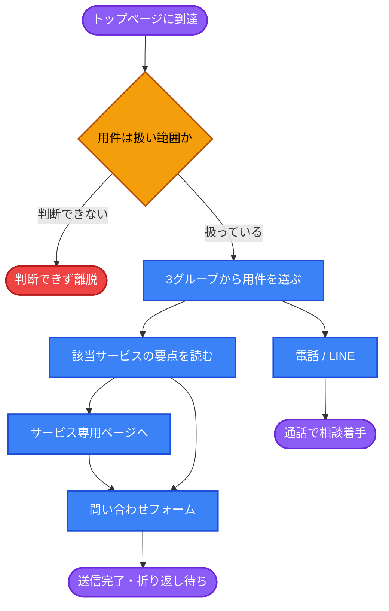
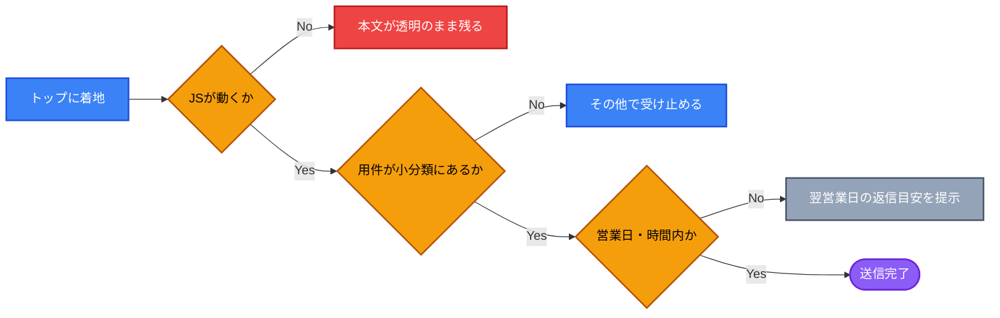

# UX Blueprint: トップページの情報構造

## 1. 🎯 Strategy & Context

### 根本原因（5 Whys）

| # | 問い | 答え |
| --- | --- | --- |
| 1 | なぜトップから正しいサービスへ分岐しないのか | 本文・ナビ・問い合わせジャンルで「扱うサービスの範囲」が三者で食い違っているため |
| 2 | なぜ食い違うのか | 三者が別の時期・別の理由で追加され、トップ全体として一度も棚卸しされていないため |
| 3 | なぜ棚卸しされないのか | 既存の設計がすべて個別機能単位で、解決策が「ジャンル選択肢に項目を足す」形に収束してきたため `[source: docs/blueprints/ux-recruit-application.md:193]` |
| 4 | なぜ個別単位なのか | 課題が「このページから次へ進めない」という形で発見され、起点ページ単位で設計されるため |
| 5 | なぜ起点ページ単位なのか | **トップページが「会社案内」として設計され、「サービスの分岐点（ハブ）」として設計されていないため** |

**根本原因: トップページがハブではなく会社案内として設計されている。** 各サービスへの導線は後から個別に足されており、全体の整合性を保つ構造が無い。

### 現状の棚卸し

扱うサービス11種が、トップのどこに存在するか `[source: app/page.tsx / lib/siteNav.ts / components/SiteHeader.tsx]`

| サービス | ヘッダー | 本文 | フッター | 問い合わせジャンル |
| --- | :---: | :---: | :---: | :---: |
| 車検・点検 | ✓ | ✓ | ✓ | ✓（車検／点検） |
| 整備・一般修理 | — | ✓ | — | ✓（整備・修理） |
| 板金修理 | — | — | — | ✓ |
| 新車販売 | ✓ | ✓ | ✓ | ✓ |
| 中古車販売 | — | ✓（同カード） | — | ✓ |
| ノレタ（個人向けローン） | ✓ | ✓（最大面積で特集） | ✓ | ✓ |
| カーローン | ✓ | ✓ | ✓ | ✓（仮審査／全般） |
| ノリドク（法人向けリース） | ✓ | **—** | ✓ | ✓ |
| 自動車保険 | — | **—** | **—** | ✓ |
| 採用 | ✓ | **—** | ✓ | ✓ |
| IT支援 | **—** | **—** | ✓ | **—** |

読み取れること:

- **IT支援だけがフッターの1リンクしか持たない** `[source: app/page.tsx:1771]`。ナビにも本文にも問い合わせジャンルにも存在しない。一方でページ実体は646行＋料金907行ある `[source: app/it-support/]`
- **ノリドク（法人向けリース）と自動車保険は本文に無い**。ナビとジャンル選択肢にはある
- **板金修理と自動車保険はジャンル選択肢にしか存在しない**。選べるが説明が無い
- ノレタが本文で最大の面積を占める `[source: app/page.tsx:596]` が、ナビでは navItems の外に直書きされている `[source: components/SiteHeader.tsx:112-118]`

### 問題の定義

- **Problem Statement**: 扱うサービス11種に対し、トップ本文が説明するのは6種、ヘッダーナビは6種、問い合わせジャンルは13択で、三者の範囲が食い違っている。来訪者は自分の用件が扱い範囲かを判断できず、判断できた場合も13択から選ばされる `[source: app/page.tsx:1364-1379 / lib/siteNav.ts]`
- **User Goal**: 自分の用件（車検なのか、リースなのか、IT相談なのか）がここで扱われているかを数秒で判断し、最短で該当窓口に着きたい `[source: chat-input]`
- **Business Goal**: ジャンル別の問い合わせ分布を実態に近づけ、「その他」送信と取りこぼしを減らす `[assumption — 数値目標は未確認]`
- **Success Metrics**:
  - 「その他」ジャンルで届く問い合わせの比率（減るほど良い）
  - トップ到達 → 各サービスページ到達率（GA4で計測可能 `[source: app/layout.tsx:228]`）
  - IT支援の問い合わせがトップ経由で届く件数（現状は導線が無いため、ほぼ0と推定）
  - `#contact` 到達 → 送信完了率（ジャンル選択での離脱を見る）

### Scope

**IN**

- トップページ本文のセクション順序と粒度
- ヘッダーナビの範囲（`lib/siteNav.ts` の項目構成）
- 問い合わせジャンルの構造（13択の整理）

**OUT**

- 各サービスページ内部のIA（既存blueprint 4件の管轄）
- IT支援の料金ページ→相談フォームの条件引き継ぎ（別課題。本セッションの候補A）
- 配色・タイポグラフィ・余白（`DESIGN_RULE.md` と `ui-implementation-specialist` の管轄）
- 最終的な文言（グループ名・ラベル・マイクロコピーは `ux-writer` の管轄）

---

## 2. 🛣️ User Flow

**Steps:**

1. トップ到達 → 2. 扱い範囲の判断 → 3. 用件グループの選択 → 4. 要点の確認 → 5. 相談着手
   - Branch A（詳細が必要）: サービス専用ページ → フォーム（条件を引き継いで着地 `[source: lib/contactHandoff.ts]`）
   - Branch B（即連絡したい）: 電話／LINE（モバイルは固定バーが常時表示 `[source: components/MobileActionBar.tsx]`）
   - Branch C（扱い範囲が判断できない）: 離脱。**現状これが IT支援・法人リース・保険で起きている**

---

## 3. 🏗️ Information Architecture

### 現状の順序 `[source: app/page.tsx]`

| # | セクション | id | 備考 |
| --- | --- | --- | --- |
| 1 | Hero | `#main` | 1956年創業・金沢市金石本町。CTAは車検と「サービスを見る」の2つ |
| 2 | サービス内容 | `#services` | ノレタ特集 → 3カード → 新車をお探しの方へ |
| 3 | 取扱車種 | `#cases` | **id と内容が不一致**（`/shinsha#lineup` とも命名が食い違う） |
| 4 | 会社情報 | `#company` | |
| 5 | 営業カレンダー | なし | 直接リンクできない |
| 6 | お客様の声 | なし | Elfsight外部ウィジェット |
| 7 | 港南ドライブチャレンジ | なし | 遊びへの離脱導線。割引コードあり |
| 8 | よくある質問 | `#faq` | |
| 9 | お問い合わせ | `#contact` | ジャンル13択＋条件付き項目 |
| 10 | フッター | — | **唯一11サービスを網羅** |

### 提案する順序（上から下への優先順位）

**1. Hero — 誰であり、何を扱うか**

- 維持: 1956年創業・所在地という信頼の手がかり、車検を第一CTAに置く構成
- 追加: 「扱う範囲」が1画面で分かる手がかり
- **WHY**: 来訪者の最初の問いは「ここは自分の用件を扱うか」。現状ファーストビューで見えるのは車検だけで、法人リース・IT支援・採用の来訪者は自分向けの会社だと判断できない（Nielsen: Match between system and the real world）

**2. 用件の分岐（新設 / サービス内容の前段）**

11サービスを3グループに圧縮して提示する。

| グループ | 含むサービス |
| --- | --- |
| クルマを直す・通す | 車検、点検、整備・一般修理、板金修理 |
| クルマを持つ | 新車、中古車、ノレタ、カーローン、ノリドク、自動車保険 |
| クルマ以外 | IT支援、採用 |

- **WHY（Miller's Law）**: 11の選択肢は一度に把握できない。3グループなら保持できる
- **WHY（Hick's Law）**: 第一選択を3つに抑える。既存blueprintも同じ原則で選択肢を圧縮している `[source: docs/blueprints/ux-shinsha-ranking.md:212 / ux-estimate-handoff.md:161]`
- **WHY**: この3グループが、以降のナビ・ジャンル選択肢と共有する唯一の分類軸になる。三者の食い違いは「共通の分類が無い」ことの帰結であり、分類を1つ決めることが本設計の本体
- 制約: グループ名の確定は `ux-writer` に引き継ぐ（上表は構造を示す仮ラベル）

**3. サービス詳細（現 `#services`）**

- 現状のノレタ特集＋3カード＋新車ブロックを、上の3グループの下に整列させる
- ノリドク（法人向けリース）と自動車保険を本文に追加する
- **WHY（Nielsen: Consistency and standards）**: ナビとジャンル選択肢に存在するのに本文に説明が無い状態は、選べるが分からないという不一致を生む。板金修理も同様
- **要判断**: ノレタが現状最大の面積を占めるが、これが意図した優先順位なのか、実装順の結果なのかは未確認（§6のAssumption 1）

**4. 取扱車種（現 `#cases`）**

- id を内容と一致させる（`#cases` → 車種を指す名前へ）
- **WHY**: `#cases`（事例）という id に車種一覧が入っており、`/shinsha#lineup` とも命名が食い違う。アンカーの意味が実体と一致しないと、外部リンク・ナビ追加のたびに誤りが再発する
- 接続: 21車種→10件の圧縮は `ux-shinsha-ranking.md` が設計済み。トップでは「車種がある」ことの提示に留め、選択は `/shinsha` に委ねる

**5. 信頼の裏付け — 会社情報 → お客様の声**

- 現状の「会社情報 → 営業カレンダー → お客様の声」から、営業カレンダーを後ろへ移す
- **WHY**: 営業カレンダーは第三者評価ではなく実務情報。判断材料としての性質が違う

**6. よくある質問（現 `#faq`）**

- 位置は維持（問い合わせの直前）
- **WHY**: 送信直前の不安解消が役割。現状位置は妥当

**7. 営業カレンダー（移動）**

- `#contact` の直前へ移す。id を付与して直接リンク可能にする
- **WHY**: フォームには希望日・希望時間の入力がある `[source: app/page.tsx:1516-1533]`。カレンダーはその入力の判断材料であり、現状はお客様の声・ゲーム・FAQ を挟んで離れている。判断材料は判断の直前に置く（Nielsen: Recognition rather than recall）

**8. お問い合わせ（`#contact`）**

- ジャンル13択を2段構成にする: 大分類（上の3グループ）→ 小分類（現行13項目を維持）
- **IT支援を小分類に追加する**（現状欠落）
- 既存の条件付き項目（車検系のナンバー、ノリドクの法人項目、採用の希望職種）は**そのまま維持** `[source: app/page.tsx:154,1454,1478]`
- **WHY（Hick's Law）**: 13択は個別blueprintが「仕分けのため」に足してきた累積結果で、構造として設計された形跡が無い `[source: docs/blueprints/ux-recruit-application.md:193]`。大分類を1段かぶせるだけで、既存の出し分けロジックを壊さずに第一選択を3〜4に減らせる
- **既存設計との整合**: `ux-lease-application.md` の「ジャンルに応じた項目出し分け」`[source: ux-lease-application.md:116]` と矛盾しない。小分類は保持されるため、出し分けの条件式は変わらない

**9. フッター**

- 11サービスの網羅は維持
- **WHY**: 現状フッターだけが全体像を持っている。上の構造が入れば、フッターは網羅性の担保という本来の役割に戻る

### ナビ（`lib/siteNav.ts`）の扱い

- 現状: `navItems` 6件 ＋ `SiteHeader` 内にノレタ／ノリドクを直書き `[source: components/SiteHeader.tsx:112-118,213-220]`
- 提案: 直書き分を `navItems` に統合し、IT支援を追加する
- **WHY**: 同じナビが2か所で管理されている状態は、サービス追加時の漏れを構造的に生む。IT支援の欠落はまさにその結果
- **WHY（Consistency）**: ただし `SiteHeader` を使うのは3ページのみ `[source: app/shaken/ app/shinsha/ app/carloan/]`。21車種・ノレタ・ノリドク・採用・IT支援は独自ヘッダーを持ち、出口リンクが最小2件（車種ページは `/` と `/noreta` のみ）しかない。**これはトップページの範囲外だが、本設計の効果を打ち消す**（§6のRisk 1）

---

## 4. ⚠️ Edge Cases

| State | Trigger | Expected Behavior |
| --- | --- | --- |
| Empty | お客様の声ウィジェットが読み込めない | Elfsight外部スクリプトに依存し、`visibleSections.reviews` が真になるまで描画されない `[source: app/page.tsx:1050]`。読み込み失敗時に空白セクションが残らないよう代替を用意する |
| Error | フォーム送信失敗 | 既存実装どおり送信ボタン直上にインライン表示し、電話番号を併記 `[source: app/page.tsx]`。既存blueprint 3件と同じ扱い |
| Loading | 送信中 | 既存の `aria-busy` とスピナーを維持 `[source: app/page.tsx]` |
| JS無効・失敗 | スクリプトが動かない | 本文セクションが `opacity-0 translate-y-4` のまま残る `[source: app/page.tsx:142]`。初回に `handleScroll()` を評価する対策は入っているが、これはJSが動く前提の対策 `[source: app/page.tsx:137]`。**IA設計の前提（上から順に読める）が崩れる** |
| 営業時間外・定休日 | `isClosedDay` が真 | 返信が翌営業日以降になる旨を提示。`lib/businessDays.ts` のデータは既にある `[source: app/page.tsx]`。`ux-recruit-application.md:158` と同じ扱いに揃える |
| 扱い範囲外 | レンタカー等、11サービスに無い用件 | 「その他」で受け止める。3グループ提示では扱い範囲が明確になるぶん、範囲外の判断も早くなる（これは意図した効果） |
| 他ページからの引き継ぎ | `readContactHandoff` で着地 | **大分類と小分類の両方を自動選択する必要がある。** 現状は小分類のみを想定した実装 `[source: lib/contactHandoff.ts]`。2段化する場合の必須対応 |
| アンカー直接着地 | `/#contact` や `/#company` で到達 | 既存実装で初回評価とスクロール移動が入っている `[source: app/page.tsx:104-112,137]`。セクション順序を変えても id を維持すれば既存リンクは壊れない。`#cases` を改名する場合のみリダイレクト相当の配慮が必要 |

---

## 5. 🧠 Heuristics Applied

| 原則 | 本設計での対応 |
| --- | --- |
| **Match between system and the real world** | 来訪者の用件（直す／持つ／クルマ以外）を分類軸にする。現状の分類軸はサービスの提供側都合（ノレタ、ノリドクという自社ブランド名）で、初回来訪者には意味が伝わらない |
| **Consistency and standards** | 本文・ナビ・ジャンル選択肢が同じ3グループを共有する。現状は三者が独立した範囲を持つ |
| **Recognition rather than recall** | 営業カレンダーを希望日時入力の直前に置く。離れた位置の情報を記憶させない |
| **Visibility of system status** | 送信中・送信結果・営業時間外の返信目安を明示（既存実装を維持・拡張） |
| **Hick's Law** | 第一選択を13→3に圧縮。小分類は大分類の選択後に開示 |
| **Miller's Law** | 11サービスを3グループに束ねる |
| **Progressive disclosure** | 大分類→小分類→条件付き項目の3段。既存の出し分け `[source: ux-lease-application.md:116]` を1段上に拡張する形 |
| **Fitts's Law** | モバイルは電話・LINEが固定バーで常時到達可能 `[source: components/MobileActionBar.tsx]`。現状維持 |

---

## 6. 📊 Risks & Assumptions

### Assumptions（検証が必要）

| # | 前提 | 検証方法 |
| --- | --- | --- |
| 1 | ノレタが本文で最大面積を占めるのは意図した優先順位である `[source: app/page.tsx:596]` | 事業側に確認。実装順の結果なら、3グループ提示後の面積配分を見直す |
| 2 | 車検が最大の流入・問い合わせ源である（Hero第一CTAの根拠） | GA4のページ別流入とジャンル別問い合わせ件数で確認 `[source: app/layout.tsx:228]` |
| 3 | IT支援をトップで扱う方針である | **未確認。** フッター1リンクのみという現状が意図的（別事業として分離したい）なら、本設計のグループ3は採用のみになる |
| 4 | ビジネスゴールの数値目標 | 未確認。§1のSuccess Metricsは測定可能な指標を置いたが、目標値は事業側の設定が必要 |
| 5 | 港南ドライブチャレンジが問い合わせ直前にある理由 `[source: app/page.tsx:1103]` | 割引コードを取得してから問い合わせる動線を意図しているなら現状位置が正しい。意図が無ければ、問い合わせ直前の遊びへの離脱導線になっている |

### Risks

| 種別 | 内容 | 緩和 |
| --- | --- | --- |
| リスク | **トップのIAを整えても、他ページの出口が狭いままでは効果が出ない。** 21車種ページの出口は `/` と `/noreta` の2件のみ `[source: app/suv/rav4/ClientPage.tsx]`、IT支援は `/` と自ページのみ `[source: app/it-support/page.tsx]` | ヘッダーの一本化（`navItems` 統合）を同時に進める。ただし独自ヘッダーのページ群への適用は本blueprintの範囲外 |
| リスク | ジャンル2段化は `contactHandoff` の全利用箇所（26ファイル）に影響する `[source: lib/contactHandoff.ts]` | 大分類は小分類から機械的に導出できる設計にし、呼び出し側の変更を不要にする |
| リスク | 3グループの分類軸を決めることが本設計の本体だが、これは事業の見せ方の決定でもある | 分類は構造の提案に留め、名称と最終的な括り方は事業側と `ux-writer` で確定する |
| リスク | 既存の4つのblueprintが未実装の部分を含む場合、本設計と実装順が衝突する | `ux-estimate-handoff.md` と `ux-recruit-application.md` は `status: draft` のまま。ジャンル選択肢への「採用・応募」追加とプライバシーリンクは実装済みを確認済み `[source: app/page.tsx:1377,1771]` |
| 計測リスク | GA4は `NEXT_PUBLIC_GA_ID` 経由で導入済みだが、セクション別の到達やジャンル選択の計測イベントは未確認 | Success Metricsの測定可否を実装前に確認する |

---

## 7. ➡️ Next Steps

### 先行して単独実施できるもの（効果が大きく、依存が無い）

1. **問い合わせジャンルにIT支援を追加する** — 1項目の追加で、現在「その他」に落ちている需要を受け止められる
2. **`#cases` の id を内容と一致させる** — 命名の不整合の解消
3. **`navItems` にノレタ／ノリドク／IT支援を統合する** — ナビの二重管理の解消

### 本設計の本体（事業側の判断が必要）

4. 3グループの分類軸の確定（Assumption 1・3の解決が前提）
5. 用件分岐ブロックの新設とセクション順序の変更
6. ジャンル選択肢の2段化（`contactHandoff` の対応を含む）

### Handoff

- `ux-writer` — 3グループの名称、分岐ブロックの見出しと説明、営業時間外の返信目安の文言
- `ui-implementation-specialist` — 分岐ブロックのレイアウト、2段セレクトの表現。配色は `tailwind.config.ts` のスケール経由で行う
- **Blocked by**: Assumption 3（IT支援をトップで扱うか）。これが決まらないとグループ3の中身が確定しない

---

## 8. 📂 Source Files Used

- `app/page.tsx` — 本文9セクション、ヘッダー、13択ジャンルのフォーム、フッター（1814行）
- `lib/siteNav.ts` — ナビ項目6件
- `components/SiteHeader.tsx` — ナビの実体。3ページのみが使用
- `components/MobileActionBar.tsx` — モバイル固定の電話・LINE
- `lib/contactHandoff.ts` — 他ページからの条件引き継ぎ（26ファイルが利用）
- `app/layout.tsx` — GA4
- `app/it-support/page.tsx`, `app/it-support/pricing/page.tsx` — トップに導線が無いページ群
- `app/suv/rav4/ClientPage.tsx` — 車種ページの出口リンクの代表例
- `docs/blueprints/ux-estimate-handoff.md`, `ux-lease-application.md`, `ux-recruit-application.md`, `ux-shinsha-ranking.md` — 先行設計4件

### 本blueprintが扱わなかった隣接課題

- **IT支援の料金ページ→相談フォームの条件引き継ぎ**（本セッションの候補A）。`ux-estimate-handoff.md` と同型の課題で、独立したblueprintが必要
- **問い合わせ窓口の分裂**（本セッションの候補C）。トップの13択フォーム、IT支援の4択フォーム `[source: app/it-support/page.tsx:573]`、電話・LINEの3系統。本blueprintの3グループが決まった後に設計すべき
