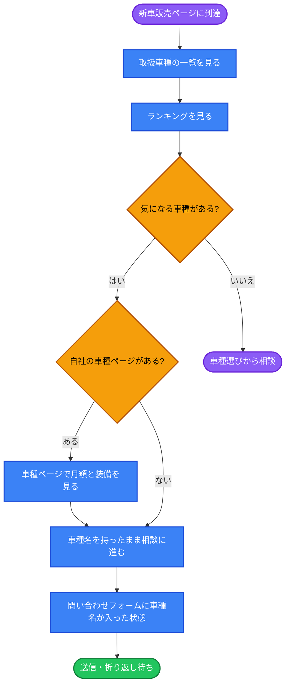
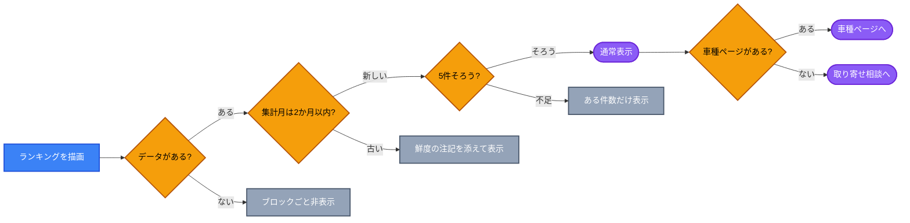

# UX Blueprint: 新車販売ランキング

実装済みのランキングブロック（2026-10-19 追加）を対象に、**掲載したあとの導線**を設計する。
視覚表現と確定コピーは対象外（それぞれ UI / UX Writer の担当）。

---

## 1. 🎯 Strategy & Context

### 根本原因（5 Whys）

| # | 問い | 答え |
| --- | --- | --- |
| 1 | なぜランキングを載せるのか | 「いま何が売れているか」を車種選びの判断材料として示すため `[source: chat-input]` |
| 2 | なぜ判断材料が要るのか | 取扱一覧は21車種あり、カテゴリと月額だけでは絞り込めないため `[source: lib/carLineup.ts]` |
| 3 | なぜ絞り込めないのか | 一覧の並び順が月額の安い順で、「人気」という最も一般的な基準が無かったため `[source: app/shinsha/ClientPage.tsx]` |
| 4 | なぜ人気を出せなかったのか | 自社の車種別販売実績を公開していないため、全国統計に頼るしかない |
| 5 | なぜそれが問題になるのか | **全国統計の母集団と、自社が車種ページを持つ母集団が一致しない。関心が高まった車種ほど次に進む先が無い** |

**根本原因: 判断材料（全国ランキング）と受け皿（自社の車種ページ）が別の母集団で、両者をつなぐ設計が無い。**

### 母集団の不一致（実測）

`lib/carRanking.ts` の10件を `lib/carLineup.ts` の21車種と突き合わせた結果：

| ランキング掲載 | 対応する車種ページ | 判定 |
| --- | --- | --- |
| N-BOX（軽1位） | `/kcar/nbox`「N-BOX カスタム」 | 近似（グレード違い） |
| スペーシア（軽2位） | `/kcar/spacia` `/kcar/spaciagear` | 近似・候補が2件 |
| タント（軽3位） | `/kcar/tantocustom` `/kcar/tantofuncross` | 近似・候補が2件 |
| ムーヴ（軽4位） | — | **遷移先なし** |
| ルークス（軽5位） | — | **遷移先なし** |
| ヤリス（乗用1位） | —（`/suv/yariscross` は別車種） | **遷移先なし** |
| カローラ（乗用2位） | —（`/suv/corollacross` は別車種） | **遷移先なし** |
| シエンタ（乗用3位） | — | **遷移先なし** |
| フリード（乗用4位） | — | **遷移先なし** |
| ランドクルーザー（乗用5位） | `/suv/landcruiser`「ランクル 250」 | 近似 |

**完全一致 0件 / 近似 4件（うち2件は候補が複数）/ 不在 6件。**
とくに乗用車は5件中4件が遷移先を持たない。

### 定義

- **Problem Statement**: ランキングで関心を持った来訪者の行き先は、10件中6件の車種で存在しない。残る4件も車名が一致せず自力で探す必要がある。結果、ランキングは「読んで終わる」静的ブロックになっている `[source: lib/carRanking.ts / lib/carLineup.ts]`
- **User Goal**: 車に詳しくない来訪者が、「みんなが買っている車」を手がかりに候補を数台に絞り、**その車が自店でいくらで買えるか**を知りたい `[source: chat-input]`
- **Business Goal**: 比較検討段階（低インテント）の来訪者を相談（高インテント）へ引き上げる。あわせて毎月更新による鮮度を、再訪とクロール頻度の根拠にする `[source: chat-input]`
- **Success Metrics**:
  1. ランキングブロックの可視化率（セクションが画面に入った訪問の割合）
  2. ランキング → 相談アクション（車種ページ経由／取り寄せ相談）の到達率
  3. 問い合わせのうち車種名が引き継がれて届いた件数 `[source: lib/contactHandoff.ts]`
  4. 〈運用指標〉集計月と公開日の乖離日数（更新が止まっていないか）
  - ⚠️ 現状 GA4 は pageview のみでイベント計装が無く、1〜3 は**いま測れない** `[source: app/layout.tsx:228]`

### スコープ

| | 内容 |
| --- | --- |
| **IN** | ランキングの情報設計、次の行動の接続、鮮度（更新漏れ）の扱い、月次更新の運用設計 |
| **OUT** | 色・字形・余白などの視覚表現、確定コピー、自社販売実績の集計、全国→石川県データへの差し替え（データ入手が別課題） |

---

## 2. 🛣️ User Flow

**ステップ**

1. 新車販売ページ到達 → 2. 取扱一覧を見る（21車種・基準が無く迷う）→ 3. ランキングで基準を得る → 4. 相談

- 分岐A（車種ページあり・4件）: ランキング → 車種ページ → 月額を確認 → 相談
- 分岐B（車種ページなし・6件）: ランキング → **取り寄せ相談**（車種名を引き継いでフォームへ）
- 分岐C（決められない）: 既存の「車種選びを相談する」CTAへ

**現状**: 分岐A・Bを実装済み（2026-10-20）。ランキングの各行がリンクになっており、`lib/carRanking.ts` の `route` を持つ4件は車種ページへ、残る6件は `buildContactUrl({ category: '新車販売', lines: ['車種: メーカー 車名'] })` で相談へ送る。

**接続方法の判断**: 新規の仕組みは作らない。車検見積りで実績のある `buildContactUrl({ category: '新車販売', lines: ['車種: ○○'] })` をそのまま使う。URLではなく人が読める要約を運ぶ設計も踏襲する `[source: lib/contactHandoff.ts / docs/blueprints/ux-estimate-handoff.md]`

---

## 3. 🏗️ Information Architecture

上から優先度順。括弧内は現状。

1. **見出し＋集計月**（実装済み）— 統計には鮮度が不可欠。見出しと同じ視線の高さに集計月を置く
2. **位置づけの1文**（実装済み）— 「全国の統計」「全車種お取り寄せ可」の2点を先に言う。これが無いと自社実績と誤読される
3. **ランキング本体**（実装済み）— 軽／乗用車の2カラム × 5件。各行は〈順位・車名・メーカー・台数〉
4. **各行からの次の行動**（実装済み・本ブループリントの主提案）— 行全体がリンクで、車種ページがあればそこへ、無ければ取り寄せ相談へ出る
5. **出典・注記**（実装済み）— 信頼性の担保。読む人は少数なので最下部でよい

### 構造上の判断とその理由

| 判断 | 理由 |
| --- | --- |
| 掲載位置を「取扱一覧のあと」にする | 一覧は月額という**購入判断**を持つ一次情報、ランキングは**候補選び**の補助情報。先に自社の商品を見せ、迷った人を受け止める順にする |
| 1カテゴリ5件に絞る | Hick's Law（選択肢が増えるほど決定が遅れる）。一覧21車種に対し10件へ圧縮すること自体が本ブロックの価値 |
| 軽と乗用車を横並びにする | 来訪者の検討は「軽か普通車か」で先に割れる。縦積みにすると下側が読まれない |
| 前年比・累計を載せない | 更新コストが2倍になり、来訪者の意思決定には寄与しない（Aesthetic and minimalist design） |
| 行から車種ページへ直結しない選択肢も残す | 名称が一致しない（N-BOX → N-BOX カスタム）ため、誤解を生む遷移になりうる。接続先を「相談」に寄せるほうが安全な場合がある |

---

## 4. ⚠️ Edge Cases

| 状態 | 契機 | 期待する振る舞い | 現状 |
| --- | --- | --- | --- |
| **更新漏れ（最重要）** | 月初の手動更新を忘れる | 集計月は常に見えるので誤認はしない。ただし2か月以上古い場合は、鮮度の注記を添えるか非表示にする。「古い統計が貼りっぱなし」はサイト全体の信頼を落とす | 対応済み（`isRankingStale()` が2か月以上古いと判定したとき、注記を添えて表示。判定は閲覧時点で行う） |
| 件数不足 | 公表側の都合で5位まで出ない | 配列の件数ぶんだけ描画して崩れない | 対応済み（配列を map するだけ） |
| データ空 | 配列が空 | ブロックごと非表示にする（見出しだけ残さない） | 対応済み（両配列が空なら `null` を返す。上の区切り線もコンポーネント側に移したので線だけ残らない） |
| 同率順位 | 台数が同じ | 公表資料の順位に従う＝配列順をそのまま使う | 対応済み（配列順＝順位） |
| 車種ページ不在 | 上位車種が取扱一覧に無い（6/10件） | 個別ページは作らず、車種名を引き継いで取り寄せ相談へ送る | 対応済み（`route` 未指定の車種は相談へフォールバック） |
| 名称不一致 | 「N-BOX」と「N-BOX カスタム」 | ランキング側は公表通称名のまま変えない。引き継ぐ車種名も公表名のままにし、グレードは相談で詰める | 対応済み（表示・引き継ぎとも公表名のまま。接続先は `route` の固定ルールで指定する） |
| 読み込み中 | — | 静的データ＋サーバーコンポーネントのため発生しない | 該当なし |
| 権限エラー | — | 認証のない公開ページのため発生しない | 該当なし |

---

## 5. 🧠 Heuristics Applied

| 原則 | 本ブロックでの扱い |
| --- | --- |
| **Visibility of system status** | 集計月を見出しの横に出し、出典を明記。統計コンテンツで「いつの数字か」が無いのは致命的（実装済み） |
| **Match between system and the real world** | 公表の通称名をそのまま使い、単位は「台」。順位は1始まり（実装済み） |
| **Recognition rather than recall** | 来訪者が車名を思い出す必要をなくす。これがランキングを置く本来の価値 |
| **Consistency and standards** | 台数はタブラー数字で桁をそろえ、カード一覧の月額表記と扱いを合わせる（実装済み） |
| **User control and freedom** | ランキングから「詳細を見る」「相談する」のどちらにも出られること（実装済み。行全体がリンクで、キーボード操作時は内側にフォーカスリングが出る） |
| **Aesthetic and minimalist design** | 前年比・累計・シェアを載せない。更新コストと可読性の両方を守る |
| **Help and documentation** | 更新手順と出典URLを `lib/carRanking.ts` 冒頭に日本語で記載（実装済み） |
| **Hick's Law** | 21車種 → 10件に圧縮。選択肢を減らすことが機能の本体 |
| **Miller's Law** | 1カテゴリ5件は短期記憶の範囲内。7件を超えると比較が働かなくなる |
| **Von Restorff / Serial position** | 1位のみ強調（実装済み）。ただし下記リスクを参照 |
| **Peak-end rule** | セクション末尾がCTAなので、ランキング直後に行動の選択肢を置く意味がある |

---

## 6. 📊 Risks & Assumptions

### 前提（検証が必要）

- **全国の人気が金沢の来訪者の判断材料になる**。石川県／金沢市の統計が入手できればそちらのほうが説得力は高い。未検証の前提
- ランキングを見た来訪者が「自店でも買える」と理解する。注記は置いたが、小さい文字で読まれない可能性がある

### リスク

| リスク | 内容 | 対応の方向 |
| --- | --- | --- |
| **誤読** | 全国統計を「この店の販売実績」と受け取られる | 位置づけの1文を本体の上に置く（実装済み）。文言は UX Writer へ |
| **運用停止** | 手動更新が止まると、鮮度の訴求が逆に「放置されたサイト」の証拠になる | 2か月超の鮮度ガード（§4）＋月初の更新リマインド |
| **1位の強調** | 「1位＝買うべき車」と読まれ、来訪者の用途に合わない車へ誘導しかねない | 強調は順位の可読性のためであり推奨ではない、と文脈で示す |
| **メーカー偏り** | 乗用車5件中4件がトヨタ。特定メーカーの店に見える | 全メーカー取り寄せ可の記載を近くに置く（実装済み） |
| **効果不明** | イベント計装が無く、設置の是非を判断できない | §7 の計装を先に入れる |

---

## 7. ➡️ Next Steps

| 優先 | 作業 | 引き継ぎ先 |
| --- | --- | --- |
| 1 | ~~各行からの接続（車種ページ／取り寄せ相談）の実装。`buildContactUrl` を再利用~~ **完了（2026-10-20）** | `ui-implementation-specialist` |
| 2 | 位置づけの1文と、接続ボタンの文言 | `ux-writer` |
| 3 | GA4 イベント計装（ブロック可視化・行クリック・相談到達） | 実装（計測設計が別途必要） |
| 4 | ~~2か月超の鮮度ガードと、データ空のときの非表示~~ **完了（2026-10-20）** | `ui-implementation-specialist` |
| 5 | 〈調査〉石川県／金沢市の車種別統計が入手できるか | — |

**決定（2026-10-20）**: 接続先は `lib/carRanking.ts` の各データが持つ任意フィールド `route` で指定する固定ルールとした。車名からの自動判定はしない。`route` 未指定の車種は相談への導線にフォールバックするため、毎月の更新では `rankingMonth` と各行の `name` / `maker` / `units` だけを書き替えればよい。

---

## 8. 📂 Source Files Used

- `components/NewCarRanking.tsx` — 実装済みの表示ブロック
- `lib/carRanking.ts` — 掲載データ（集計月・軽5件・乗用車5件）と更新手順
- `lib/carLineup.ts` — 自社が車種ページを持つ21車種（母集団の突き合わせに使用）
- `app/shinsha/ClientPage.tsx` — 掲載位置（取扱一覧とCTAの間）
- `lib/contactHandoff.ts` — 条件を引き継いで相談へ送る既存の仕組み
- `app/layout.tsx` — GA4 の実装状況（pageview のみ）
- `docs/blueprints/ux-estimate-handoff.md` — 同種の課題（導線の断絶）に対する先行設計
